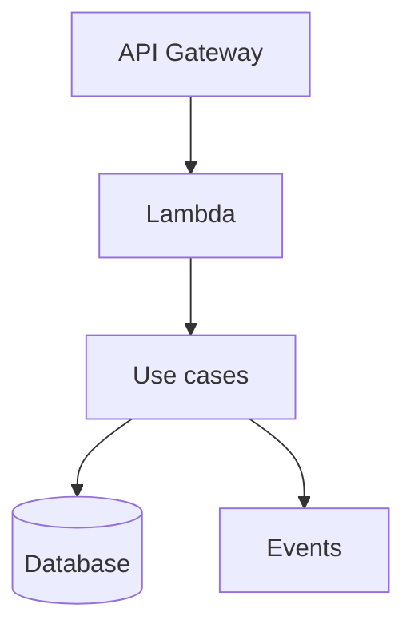

# WikiAlegra Microservice Documentation

Use this skill when the user asks to create, update, improve, migrate, or link technical documentation for a microservice in WikiAlegra using the WikiAlegra MCP.

## Goal

Create or update clear, accurate, discoverable WikiAlegra documentation for a microservice, based on the current repository state and the existing wiki hierarchy.

The documentation should be similar to the existing Ledger microservice docs: concise but complete, technical, operationally useful, and aligned with the TMD owner.

## Required Inputs

Before writing, determine or ask for:

- Microservice name.
- Repository name and current working directory.
- TMD / owner team.
- Whether to create a new document, update an existing one, or both.
- Preferred parent document or wiki area, if the user knows it.
- Whether existing docs should be preserved as historical references.

If the user says the TMD is Ledger, use `TMD Ledger` as the owner, not an individual person.

## WikiAlegra MCP Rules

Use the WikiAlegra MCP tools.

Important rules:

- Never start document content with a top-level H1. The document title is stored separately in the `title` field.
- Use `create_document` for new docs.
- Use `update_document` with `editMode: "patch"` for existing docs whenever possible.
- Avoid `editMode: "replace"` unless the user explicitly asks to fully rewrite a document.
- When patching, use exact `findText` copied from the existing document.
- Preserve existing technical content unless the user explicitly asks to replace it.
- If updating an index or old document, make the smallest useful patch.
- Use real markdown newlines, not escaped `\n`.
- Use WikiAlegra mentions only when needed and only with the correct format: `@[Display Name](mention://user/userId)`.

## Workflow

### 1. Explore The Repository

Inspect the codebase before writing documentation.

Prioritize:

- `README.md`
- `AGENTS.md`
- `package.json`
- `docs/`
- `lambdas/`
- `stacks/`
- `stacks/resources/`
- `layers/`
- `src/`
- `tests/`
- `.env.example`

Extract:

- Purpose of the microservice.
- Runtime and stack.
- Main domains/entities.
- Lambdas, workers, queues, topics, triggers and APIs.
- Persistence stores.
- External integrations.
- Environment variables.
- Migration flows.
- Outbox or retry mechanisms.
- Observability and operational concerns.
- Testing commands.
- Known gaps or TODOs.

Do not assume documentation in `AGENTS.md` is fully current. Verify against actual files when possible.

### 2. Explore WikiAlegra

Search WikiAlegra before creating anything.

Use:

- `list_collections`
- `list_documents`
- `fetch`
- `list_collection_documents` when needed

Find:

- The correct collection.
- The TMD parent document.
- Existing microservice index documents.
- Similar documents to use as style/reference.
- Existing documentation for the same repository or domain.
- Old docs that should be linked instead of overwritten.

For Ledger microservices, common target hierarchy is:

- `Alegraland`
- `Development`
- `Dominios`
- `TMD Ledger`
- `Conceptos y Microservicios - Ledger`

If an existing document is outdated but still valuable, prefer creating a new comprehensive document and adding a short note/link in the old one.

### 3. Decide Create vs Update

Prefer creating a new document when:

- Existing docs are scoped to an older phase.
- Existing docs are authored for a specific historical migration.
- The microservice has evolved significantly.
- The title is too narrow for the current scope.
- Updating would mix unrelated concerns.

Prefer updating an existing document when:

- It is clearly the canonical microservice doc.
- It only needs small corrections.
- The user explicitly asks to update it.

If unsure, ask one short question with options.

### 4. Document Structure

For a full microservice document, use this structure.

Do not include a top-level H1 in the content.

Start with a short paragraph:

```markdown
Documento técnico del microservicio `repo-name`, responsable de ...
```

Then use sections:

```markdown
## Resumen

## Repositorio

## Equipo y responsables

## Alcance funcional

## Contextos principales

## Arquitectura general

## API / Endpoints

## Lambdas / Workers / Consumers

## Flujos principales

## Dominio y modelos

## Persistencia e infraestructura

## Eventos y mensajería

## Migraciones

## Variables de entorno clave

## Observabilidad

## Troubleshooting operativo

## Testing

## Documentación relacionada

## Notas de mantenimiento
```

Adapt sections to the repo. Remove irrelevant sections. Add specific sections when useful, for example:

- `## Flujo Outbox`
- `## Flujo Kafka`
- `## Pipeline SQS`
- `## Backfill checklist`
- `## Contrato Kafka`
- `## Seguridad y permisos`
- `## Feature flags`

### 5. Content Style

Write in Spanish unless the user asks otherwise.

Keep tone technical and practical.

Use:

- Tables for lambdas, endpoints, env vars and integrations.
- Mermaid diagrams when they clarify architecture.
- Short operational runbooks for troubleshooting.
- Exact names of files, lambdas, queues, topics and env vars when known.
- Code blocks only for useful snippets, contracts, commands or examples.

Avoid:

- Marketing language.
- Overly long explanations.
- Duplicating entire existing docs.
- Claiming something is deployed/enabled unless verified.
- Naming a person as owner when the owner is a TMD/team.

### 6. Owner Rules

For team-owned microservices:

```markdown
| Campo | Valor |
|-------|-------|
| TMD | Ledger |
| Owner técnico | TMD Ledger |
| Tag AWS Owner | `Ledger` |
```

Only mention a person if the user explicitly asks or the wiki document requires a contact person field.

### 7. Create The Document

Use `create_document` with:

- `title`: concise title, usually `Microservicio <domain/name>`
- `parentDocumentId`: the selected parent doc
- `icon`: optional, e.g. `📘`, `🧾`, `⚙️`
- `publish`: `true`
- `text`: markdown content without H1

Example title patterns:

- `Microservicio Ledger Accounting Parametrization`
- `Microservicio Ledger Categories v2`
- `Microservicio de Asientos Contables v2`

### 8. Link The Document

After creating a new canonical doc, consider small patches to:

- The TMD microservice index.
- Existing old docs for the same repo.
- Parent overview documents.

Examples:

```markdown
16. **Parametrización contable ([Microservicio Ledger Accounting Parametrization](https://wiki.alegra.com/doc/...))** Centraliza la relación entre recursos de plataforma y cuentas contables...
```

Old doc note:

```markdown
> Nota de actualización: este documento se conserva como referencia técnica de la fase de Ítems. La documentación comprehensiva y actual del microservicio vive en [Microservicio ...](https://wiki.alegra.com/doc/...).
```

Do not rewrite old docs unless asked.

### 9. Verification

After creating or updating:

- Confirm the new document URL.
- Confirm parent breadcrumb if returned by the tool.
- Confirm any index or old docs patched.
- Mention any notable assumptions or gaps.

Final response should be concise:

```markdown
Documentación creada y enlazada.

- Nuevo documento: ...
- URL: ...
- Actualicé: ...
```

## Checklist Before Publishing

- The doc does not start with H1.
- Owner is the TMD/team, not a person, unless explicitly requested.
- Existing docs were searched first.
- Similar docs were used as style reference.
- Current code was verified, not only `AGENTS.md`.
- Lambda names, routes, triggers and env vars are accurate.
- Outdated docs were preserved and linked when useful.
- Index docs were patched with minimal changes.
- No unrelated wiki content was modified.

## Example Microservice Summary Template

````markdown
Documento técnico del microservicio `repo-name`, responsable de ...

## Resumen

`Service Name` es un microservicio serverless construido con TypeScript, AWS CDK/CdkLess y una arquitectura orientada a DDD/Clean Architecture. Su responsabilidad principal es ...

## Repositorio

* Repositorio backend: `repo-name`
* Dominio Wiki: `TMD Ledger › Conceptos y Microservicios - Ledger`
* Lenguaje principal: TypeScript
* Infraestructura: AWS CDK/CdkLess
* Arquitectura: DDD/Clean Architecture, Lambdas serverless

## Equipo y responsables

| Campo | Valor |
|-------|-------|
| TMD | Ledger |
| Owner técnico | TMD Ledger |
| Tag AWS Owner | `Ledger` |

## Alcance funcional

| Flujo | Entrada | Propósito |
|-------|---------|-----------|
| API HTTP | API Gateway | Operaciones síncronas del dominio. |
| Eventos | Kafka/SNS/SQS | Procesamiento asíncrono. |
| Migración | SQS/manual | Backfill histórico. |

## Arquitectura general



## Troubleshooting operativo

### Evento no se procesa

Validar:

1. Trigger habilitado.
2. Variables de entorno.
3. Credenciales y permisos.
4. Logs del handler.
5. DLQ o reintentos.
````
